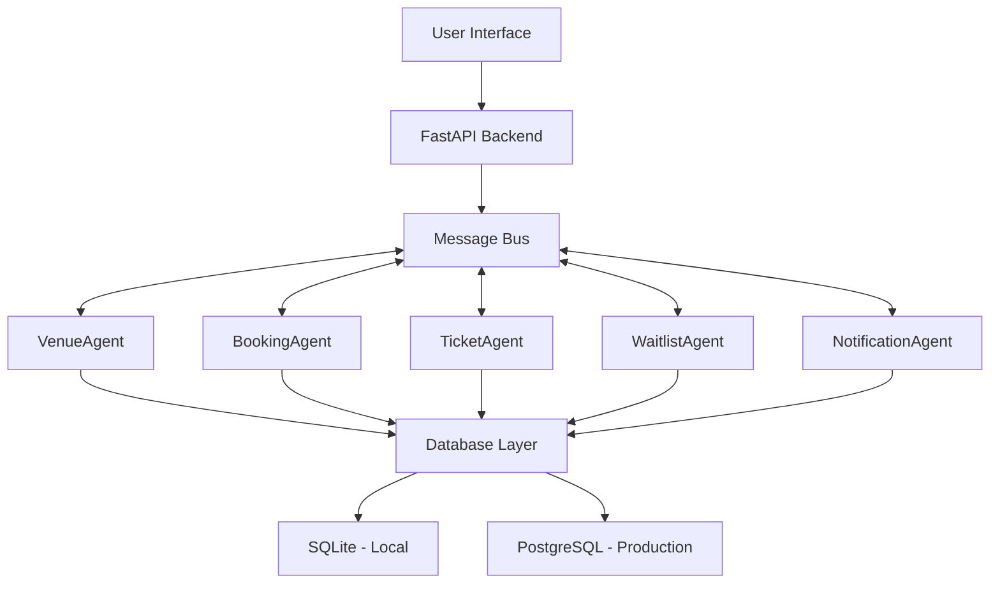

# EventSphere – Multi-Agent Event Management System

## 1. Project Overview

EventSphere is a web-based multi-agent event management system developed for IT4123 – Agent Based Computing, Practical ICA 02.

The system automates event management, venue reservations, ticket bookings, QR code validation, waitlist management and user notifications through five intelligent software agents.

## 2. Project Objectives

- Automate event and venue management.
- Implement a multi-agent architecture.
- Enable communication between independent agents.
- Prevent ticket overbooking and venue scheduling conflicts.
- Provide secure QR code-based ticket validation.
- Automate waitlist management and notifications.
- Deploy a functional web application using a cloud database.

## 3. Live Website and Repository

- Live Website: https://eventsphere-fastapi-project.onrender.com
- GitHub Repository: https://github.com/hazeebahamed/EventSphere_FastApi_Project

## 4. Technologies Used

| Technology | Purpose |
|---|---|
| Python 3.12 | Backend programming |
| FastAPI | Web application framework |
| SQLAlchemy | Database ORM |
| SQLite | Local development database |
| PostgreSQL | Production database |
| Pydantic | Data validation |
| HTML5 | Website structure |
| CSS3 | Website styling |
| JavaScript | Client-side functionality |
| Bootstrap | Responsive user interface |
| Jinja2 | HTML templates |
| QRCode | QR code generation |
| Pytest | Automated testing |
| GitHub | Version control |
| Render | Cloud deployment |

## 5. System Features

### Administrator

- Create and manage venues.
- Create, publish and cancel events.
- Configure ticket categories, prices and quantities.
- Approve or reject private venue hire requests.
- View event statistics.
- Monitor agent communication logs.

### Attendee

- Register and log in.
- Search and browse published events.
- Reserve and purchase tickets using simulated payments.
- View booking history.
- Access unique QR code tickets.
- Cancel bookings and receive eligible refunds.
- Join event waitlists.
- Request private venue reservations.
- Receive system notifications.

### Staff

- Access ticket validation interface.
- Scan or manually enter ticket codes.
- Validate event tickets.
- Prevent duplicate ticket usage.

## 6. Multi-Agent Architecture

EventSphere contains five independent software agents.

### VenueAgent

- Checks venue availability.
- Detects scheduling conflicts.
- Validates venue capacity.
- Applies a 30-minute scheduling buffer.
- Automatically approves eligible private hire requests.
- Escalates larger requests to administrators.
- Suggests alternative reservation times.

### BookingAgent

- Processes ticket reservations.
- Checks ticket availability.
- Prevents concurrent overbooking.
- Handles simulated payments.
- Processes cancellations and refunds.
- Coordinates with TicketAgent and WaitlistAgent.

### TicketAgent

- Generates unique ticket codes.
- Supports QR code ticket generation.
- Validates tickets during event check-in.
- Rejects duplicate, invalid and cancelled tickets.
- Prevents tickets from being used for incorrect events.

### WaitlistAgent

- Manages waiting lists.
- Follows first-in-first-out allocation.
- Offers newly available tickets.
- Provides a 10-minute reservation hold.
- Processes expired holds.
- Reallocates available tickets automatically.

### NotificationAgent

- Generates user notifications.
- Communicates booking confirmations.
- Sends cancellation and refund notifications.
- Notifies attendees about waitlist offers.
- Communicates venue reservation updates.

## 7. Agent Communication

The agents communicate through a centralized message bus using structured JSON messages.

Example message:

```json
{
  "sender": "BookingAgent",
  "receiver": "TicketAgent",
  "performative": "REQUEST",
  "content": {
    "action": "issue_tickets",
    "booking_id": 1
  },
  "conversation_id": "example-conversation-001"
}
```

Supported communication performatives:

- REQUEST - Request an action.
- AGREE - Accept a request.
- REFUSE - Reject a request.
- PROPOSE - Suggest an alternative.
- INFORM - Communicate information.
- FAILURE - Report an unsuccessful action.

Agent communication records are stored in the database for monitoring and auditing.

## 8. System Architecture



## 9. Agent Decision-Making Rules

| Rule | Description |
|---|---|
| Venue scheduling buffer | 30 minutes |
| Automatic private hire approval | Eligible requests with up to 100 guests |
| Maximum tickets per booking | 6 tickets |
| Waitlist allocation | First-in-first-out |
| Waitlist reservation hold | 10 minutes |
| Early check-in | Up to 60 minutes before an event |
| Duplicate ticket validation | Rejected |
| Event cancellation | Full refund |

### Booking Cancellation Policy

- 48 hours or more before the event: 100% refund.
- 24 hours or more but less than 48 hours: 50% refund.
- Less than 24 hours before the event: No refund.

## 10. Database Configuration

EventSphere supports two database environments.

### SQLite

SQLite is used for local development and testing.

Database file:

```text
eventsphere.db
```

### PostgreSQL

PostgreSQL is used in the production environment hosted on Render.

SQLAlchemy enables the application to use either database by configuring the DATABASE_URL environment variable.

The local and production databases store their data independently.

## 11. Project Structure

```text
EventSphere/
├── agents/
│   ├── venue_agent.py
│   ├── booking_agent.py
│   ├── ticket_agent.py
│   ├── waitlist_agent.py
│   ├── notification_agent.py
│   └── message_bus.py
├── static/
├── templates/
├── tests/
│   └── test_agents.py
├── auth.py
├── database.py
├── main.py
├── models.py
├── schemas.py
├── seed.py
├── requirements.txt
├── .gitignore
└── README.md
```

## 12. Installation and Local Execution

Clone the repository:

```bash
git clone https://github.com/hazeebahamed/EventSphere_FastApi_Project.git
cd EventSphere_FastApi_Project
```

Create a virtual environment:

```powershell
python -m venv venv
```

Activate the virtual environment on Windows:

```powershell
.\venv\Scripts\Activate.ps1
```

Install dependencies:

```bash
pip install -r requirements.txt
```

Create a .env file in the project directory:

```env
DATABASE_URL=sqlite:///./eventsphere.db
SECRET_KEY=replace-with-a-secure-random-secret
PRODUCTION=false
ADMIN_DEMO_PASSWORD=replace-with-admin-password
STAFF_DEMO_PASSWORD=replace-with-staff-password
ATTENDEE_DEMO_PASSWORD=replace-with-attendee-password
```

Initialize the database and demo accounts:

```bash
python seed.py
```

Start the application:

```bash
uvicorn main:app --reload
```

Open the application:

http://127.0.0.1:8000

## 13. Demo Accounts

The system supports three user roles:

| Role | Purpose |
|---|---|
| Administrator | Event and venue management |
| Staff | Ticket validation |
| Attendee | Ticket booking and venue reservations |

Demo login credentials are provided separately to the lecturer for security purposes.

New attendees can also register through the website.

## 14. Automated Testing

The system uses Pytest to validate agent functionality.

Run the tests using:

```bash
python -m pytest tests/test_agents.py -v
```

### Local Test Results

| Test Category | Result |
|---|---|
| Successful booking | Passed |
| Overbooking prevention | Passed |
| Concurrent booking | Passed |
| Invalid ticket quantity | Passed |
| Unique ticket generation | Passed |
| Duplicate check-in prevention | Passed |
| Incorrect event validation | Passed |
| Early check-in validation | Passed |
| Refund policy | Passed |
| Booking cancellation | Passed |
| Event cancellation | Passed |
| Venue scheduling conflict | Passed |
| Venue capacity validation | Passed |
| Automatic venue confirmation | Passed |
| Administrator escalation | Passed |
| Waitlist registration | Passed |
| Waitlist offer and claim | Passed |
| Waitlist expiry and reallocation | Passed |
| Notification generation | Passed |
| Agent message logging | Passed |

**Total Tests: 20**  
**Passed: 20**  
**Failed: 0**  
**Success Rate: 100%**

## 15. Cloud Deployment

The application is deployed on Render using PostgreSQL.

Build command:

```bash
pip install -r requirements.txt
```

Start command:

```bash
python seed.py && uvicorn main:app --host 0.0.0.0 --port $PORT
```

Production configuration is managed through environment variables.

## 16. Security Features

- Password hashing.
- Role-based access control.
- Session-based authentication.
- CSRF protection.
- Secure environment variables.
- Unique and unpredictable ticket codes.
- Duplicate ticket usage prevention.
- HTTPS in the production environment.

## 17. Current Limitations

- Payments are simulated rather than processed through a real payment gateway.
- Notifications are delivered within the application.
- The free Render hosting service may require additional startup time after inactivity.
- Local and production databases are maintained separately.
- Event times may be displayed in UTC.

## 18. Future Improvements

- Real payment gateway integration.
- Email and SMS notifications.
- Advanced reporting and analytics.
- Improved time zone localization.
- Dedicated mobile application.
- Further scalability improvements.

## 19. Conclusion

EventSphere demonstrates the practical implementation of a multi-agent system in event management. Its five cooperating agents automate reservations, bookings, ticket validation, waitlist allocation and notifications.

The project combines agent-based computing, database management, automated testing and cloud deployment into a functional web application.

## 20. Academic Information

- Module: IT4123 - Agent Based Computing
- Assignment: Practical ICA 02
- Project: EventSphere
- Year: 2026

Developed for academic purposes.
